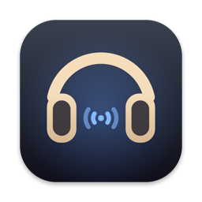

<h1 align="center">Headphone Control (Kulaklık Kontrol)</h1>

AirPods-style switching for your Sony WH-1000XM5. 
Bring audio back to your Mac from the menu bar or let it switch when Mac audio starts. Adjust noise canceling, ambient sound and EQ from the same menu.

  <a href="https://testflight.apple.com/join/e7S1TqA1"><b>Join the free TestFlight beta</b></a> ·
  <a href="https://kulaklikkontrol.github.io/en/">Website</a> ·
  <a href="https://kulaklikkontrol.github.io/privacy.html">Privacy</a>

The 15-second demo uses an illustrated Bluetooth workflow and a screenshot of the app.

## Founding 100

The first 100 testers can opt in to a public thank-you. If a paid edition is ever released, they get lifetime access at no charge. [See live campaign progress](https://kulaklikkontrol.github.io/en/#founding-100-en).

- **Requirements:** macOS 14 or later, a Sony headphone paired with the Mac.
- **Tested on hardware:** WH-1000XM5 only. One beta tester reported the WH-CH720N works (user report, not tested by the developer). Other models (WH-1000XM4, WH-1000XM6, WF-1000XM4/XM5, LinkBuds, ULT Wear…) are untested; that is exactly what the beta is for.
- **Cost:** free. No account, no analytics, no ads.

**How to help (about 5 minutes):**

1. Open <https://testflight.apple.com/join/e7S1TqA1> on your Mac and install via TestFlight.
2. With your headphones already paired, start playback on your phone, pause it and try **Play on Mac** from the headphone menu. Try ANC, Ambient Sound and EQ too.
3. Send feedback from TestFlight (or open an issue here) with your headphone model, firmware version, macOS version and what worked or didn't.

Not affiliated with or endorsed by Sony. "Sony", "WH-1000XM5" etc. are trademarks of their respective owners.

---

**Türkçe:** Sony WH-1000XM5 için AirPods tarzı geçiş. Sesi menü çubuğundan Mac’e al veya Mac’te ses başladığında otomatik geçişi kullan. [Kurucu 100](https://kulaklikkontrol.github.io/tr/#founding-100) · [Ücretsiz beta](https://testflight.apple.com/join/e7S1TqA1)
