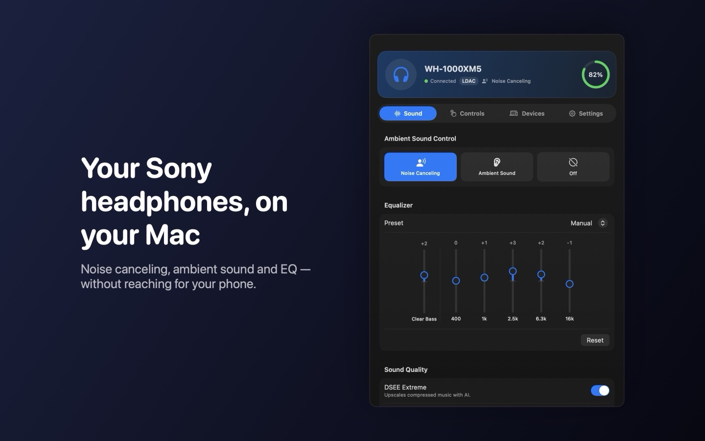

<h1 align="center">Headphone Control (Kulaklık Kontrol)</h1>

A small, free macOS menu bar app for Sony Bluetooth headphones. 
Switch Noise Cancelling / Ambient Sound / Off, set the ambient level, pick an EQ preset and see battery without reaching for your phone.

  <a href="https://testflight.apple.com/join/e7S1TqA1"><b>Join the free TestFlight beta</b></a> ·
  <a href="https://kulaklikkontrol.github.io/">Website</a> ·
  <a href="https://kulaklikkontrol.github.io/privacy.html">Privacy</a>

## Beta testers wanted

Sony's own app only runs on phones, so on a Mac you normally have to pick up the phone just to toggle noise cancelling. Headphone Control puts those controls in the menu bar.

- **Requirements:** macOS 14 or later, a Sony headphone paired with the Mac.
- **Tested on hardware:** WH-1000XM5 only. Other models (WH-1000XM4, WH-1000XM6, WF-1000XM4/XM5, LinkBuds, ULT Wear, WH-CH720N…) are untested; that is exactly what the beta is for.
- **Cost:** free. No account, no analytics, no ads.

**How to help (about 5 minutes):**

1. Open <https://testflight.apple.com/join/e7S1TqA1> on your Mac and install via TestFlight.
2. Click the headphone icon in the menu bar and try ANC / Ambient / EQ.
3. Send feedback from TestFlight (or open an issue here) with your headphone model, firmware version, macOS version and what worked or didn't.

Not affiliated with or endorsed by Sony. "Sony", "WH-1000XM5" etc. are trademarks of their respective owners.

---

**Türkçe:** Sony kulaklıklar için ücretsiz macOS menü çubuğu uygulaması (gürültü engelleme, ortam sesi, EQ, pil). Beta için: <https://testflight.apple.com/join/e7S1TqA1>
