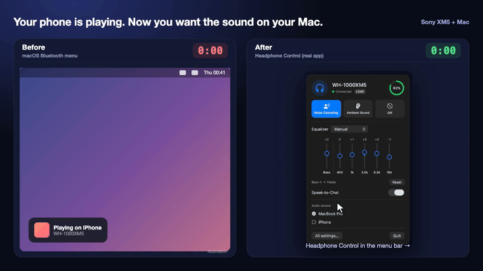

<h1 align="center">Headphone Control (Kulaklık Kontrol)</h1>

<b>AirPods-style switching for your Sony WH-1000XM5 — Mac ↔ iPhone in one click.</b> 
“Play on Mac” in the menu bar brings the sound back from your iPhone, or let it switch automatically when Mac audio starts. Noise canceling, ambient sound and EQ live in the same menu.

  
   
  <a href="https://kulaklikkontrol.github.io/en/">Website</a> ·
  <a href="https://kulaklikkontrol.github.io/en/#founding-100">Founding 100: 31/100 testers</a> ·
  <a href="https://kulaklikkontrol.github.io/privacy.html">Privacy</a>

Before: digging through Bluetooth menus. After: one click. The left side of the 15-second demo is illustrative; the right side uses real app screenshots.

## Join in 3 steps (about 1 minute)

1. Install Apple’s free [TestFlight](https://apps.apple.com/app/testflight/id899247664) app **on your Mac**.
2. Open <https://testflight.apple.com/join/e7S1TqA1> and click **Accept**.
3. Open TestFlight on your Mac and click **Install**. Accepting alone does not install the app.

Accepted on your iPhone? It’s already waiting in TestFlight on your Mac under the same Apple ID — just click **Install** there.

## Founding 100

The real external tester count from App Store Connect is shown on the [website](https://kulaklikkontrol.github.io/en/#founding-100) (31/100 on 19 Nov 2026). The first 100 testers can opt in to a public thank-you, and if a paid edition is ever released they get it free for life.

- **Requirements:** macOS 14 or later, a Sony headphone paired with the Mac.
- **Earlier hardware testing:** Sony WH-1000XM5 only. All other models are experimental, including Sony WH-1000XM4/XM6, WF-1000XM models, LinkBuds, ULT WEAR and WH-CH720N. One WH-CH720N owner reported a positive result on their setup. We welcome reports with the model and firmware version.
- **Cost:** free. No account, no analytics, no ads.

**Feedback:** send it from TestFlight (or open an issue here) with your headphone model, firmware, macOS version and what worked or didn’t. Including “XM5 switch test” helps.

Not affiliated with or endorsed by Sony. "Sony", "WH-1000XM5" etc. are trademarks of their respective owners.

---

**Türkçe:** Sony WH-1000XM5 için AirPods tarzı geçiş. Sesi menü çubuğundan Mac’e al veya Mac’te ses başladığında otomatik geçişi kullan. [Kurucu 100](https://kulaklikkontrol.github.io/tr/#founding-100) · [Ücretsiz beta](https://testflight.apple.com/join/e7S1TqA1)
